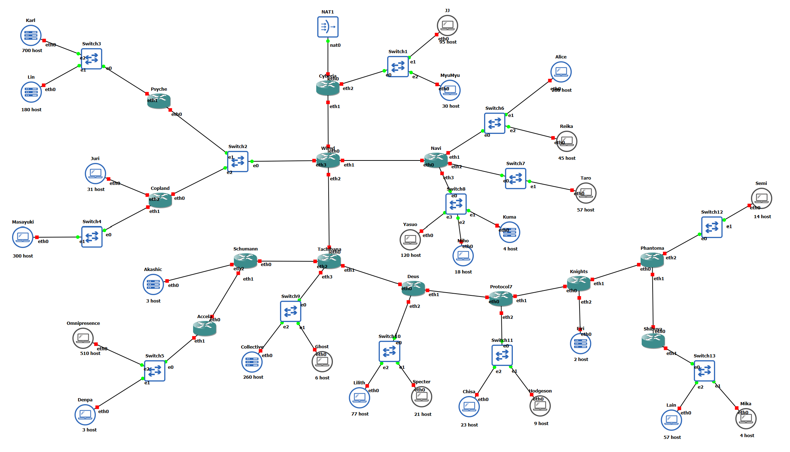

# JARKOM MODUL 4 2026 - K61

## Member

| Nama               | NRP        |
| ------------------ | ---------- |
| Ferlin Erdina Sari | 5027251002 |
| Achmad Rifqy Aqila | 5027251102 |

---

# GNS3 - VLSM

## 1. Tujuan

1. Membagi blok `10.94.0.0/16` menjadi subnet dengan metode **VLSM** sesuai jumlah host tiap segmen.
2. Mengkonfigurasi IP address dan _static routing_ pada seluruh router dan client di GNS3.
3. Memastikan seluruh node saling terhubung (ping) dan dapat keluar ke internet melalui Cyberia (NAT).

## 2. Topologi

Topologi terdiri dari 13 router (Cyberia, Wired, Navi, Tachibana, Schumann, Accela, Deus, Protocol7, Knights, Phantoma, Shibuya, Psyche, Copland), 13 switch, dan 25 node client/server. Cyberia adalah satu-satunya router yang terhubung ke NAT.



### Koneksi interface router

| Router    | eth0      | eth1      | eth2      | eth3    |
| --------- | --------- | --------- | --------- | ------- |
| Cyberia   | NAT1      | Wired     | Switch1   | -       |
| Wired     | Cyberia   | Navi      | Tachibana | Switch2 |
| Navi      | Wired     | Switch6   | Switch7   | Switch8 |
| Tachibana | Wired     | Deus      | Schumann  | Switch9 |
| Schumann  | Tachibana | Accela    | Akashic   | -       |
| Accela    | Schumann  | Switch5   | -         | -       |
| Deus      | Tachibana | Protocol7 | Switch10  | -       |
| Protocol7 | Deus      | Knights   | Switch11  | -       |
| Knights   | Protocol7 | Phantoma  | Eiri      | -       |
| Phantoma  | Knights   | Shibuya   | Switch12  | -       |
| Shibuya   | Phantoma  | Switch13  | -         | -       |
| Psyche    | Switch2   | Switch3   | -         | -       |
| Copland   | Switch2   | Switch4   | Juri      | -       |

Semua client/server menggunakan `eth0`.

## 3. Analisis Kebutuhan IP

Ketentuan: **jumlah IP subnet = jumlah host + jumlah interface router pada subnet tersebut + 2** (alamat network dan broadcast), lalu dibulatkan ke pangkat dua terdekat.

Pertimbangan rancangan:

- Switch bekerja di Layer 2, sehingga **semua host yang terhubung ke satu switch berada pada satu subnet** dengan gateway berupa interface router yang terhubung ke switch tersebut. Switch tidak diberi IP dan tidak membutuhkan subnet tersendiri.
- Switch2 menghubungkan tiga router (Wired, Psyche, Copland), sehingga ketiganya berada pada satu subnet /29.
- Link antar-router (_point-to-point_) memakai /30.
- Link Cyberia–NAT1 memperoleh alamat otomatis dari NAT (DHCP), sehingga tidak dialokasikan dari `10.94.0.0/16`.

### Tabel Subnet

| Subnet | Rute                             | Host | Interface Router | Kebutuhan (host + router + 2) | Jumlah IP | Netmask |
| ------ | -------------------------------- | ---- | ---------------- | ----------------------------- | --------- | ------- |
| A1     | Switch3 > Karl, Lin              | 880  | 1                | 880 + 1 + 2 = 883             | 1024      | /22     |
| A2     | Switch5 > Omnipresence, Denpa    | 513  | 1                | 513 + 1 + 2 = 516             | 1024      | /22     |
| A3     | Switch9 > Collective, Ghost      | 266  | 1                | 266 + 1 + 2 = 269             | 512       | /23     |
| A4     | Switch4 > Masayuki               | 300  | 1                | 300 + 1 + 2 = 303             | 512       | /23     |
| A5     | Switch6 > Alice, Reika           | 253  | 1                | 253 + 1 + 2 = 256             | 256       | /24     |
| A6     | Switch8 > Yasuo, Miho, Kuma      | 142  | 1                | 142 + 1 + 2 = 145             | 256       | /24     |
| A7     | Switch10 > Lilith, Specter       | 98   | 1                | 98 + 1 + 2 = 101              | 128       | /25     |
| A8     | Switch1 > JJ, MyuMyu             | 125  | 1                | 125 + 1 + 2 = 128             | 128       | /25     |
| A9     | Switch11 > Chisa, Hodgeson       | 32   | 1                | 32 + 1 + 2 = 35               | 64        | /26     |
| A10    | Switch7 > Taro                   | 57   | 1                | 57 + 1 + 2 = 60               | 64        | /26     |
| A11    | Switch13 > Lain, Mika            | 61   | 1                | 61 + 1 + 2 = 64               | 64        | /26     |
| A12    | Copland > Juri                   | 31   | 1                | 31 + 1 + 2 = 34               | 64        | /26     |
| A13    | Switch12 > Semi                  | 14   | 1                | 14 + 1 + 2 = 17               | 32        | /27     |
| A14    | Switch2 > Wired, Psyche, Copland | 0    | 3                | 0 + 3 + 2 = 5                 | 8         | /29     |
| A15    | Schumann > Akashic               | 3    | 1                | 3 + 1 + 2 = 6                 | 8         | /29     |
| A16    | Knights > Eiri                   | 2    | 1                | 2 + 1 + 2 = 5                 | 8         | /29     |
| A17    | Cyberia > Wired                  | 0    | 2                | 0 + 2 + 2 = 4                 | 4         | /30     |
| A18    | Wired > Navi                     | 0    | 2                | 0 + 2 + 2 = 4                 | 4         | /30     |
| A19    | Wired > Tachibana                | 0    | 2                | 0 + 2 + 2 = 4                 | 4         | /30     |
| A20    | Tachibana > Schumann             | 0    | 2                | 0 + 2 + 2 = 4                 | 4         | /30     |
| A21    | Schumann > Accela                | 0    | 2                | 0 + 2 + 2 = 4                 | 4         | /30     |
| A22    | Tachibana > Deus                 | 0    | 2                | 0 + 2 + 2 = 4                 | 4         | /30     |
| A23    | Deus > Protocol7                 | 0    | 2                | 0 + 2 + 2 = 4                 | 4         | /30     |
| A24    | Protocol7 > Knights              | 0    | 2                | 0 + 2 + 2 = 4                 | 4         | /30     |
| A25    | Knights > Phantoma               | 0    | 2                | 0 + 2 + 2 = 4                 | 4         | /30     |
| A26    | Phantoma > Shibuya               | 0    | 2                | 0 + 2 + 2 = 4                 | 4         | /30     |

## 4. Tabel VLSM

Alokasi dilakukan berurutan mulai dari `10.94.0.0`, dari subnet terbesar ke terkecil.

| Subnet | Network ID   | Netmask         | Broadcast    | Range IP                    |
| ------ | ------------ | --------------- | ------------ | --------------------------- |
| A1     | 10.94.0.0    | 255.255.252.0   | 10.94.3.255  | 10.94.0.1 - 10.94.3.254     |
| A2     | 10.94.4.0    | 255.255.252.0   | 10.94.7.255  | 10.94.4.1 - 10.94.7.254     |
| A3     | 10.94.8.0    | 255.255.254.0   | 10.94.9.255  | 10.94.8.1 - 10.94.9.254     |
| A4     | 10.94.10.0   | 255.255.254.0   | 10.94.11.255 | 10.94.10.1 - 10.94.11.254   |
| A5     | 10.94.12.0   | 255.255.255.0   | 10.94.12.255 | 10.94.12.1 - 10.94.12.254   |
| A6     | 10.94.13.0   | 255.255.255.0   | 10.94.13.255 | 10.94.13.1 - 10.94.13.254   |
| A7     | 10.94.14.0   | 255.255.255.128 | 10.94.14.127 | 10.94.14.1 - 10.94.14.126   |
| A8     | 10.94.14.128 | 255.255.255.128 | 10.94.14.255 | 10.94.14.129 - 10.94.14.254 |
| A9     | 10.94.15.0   | 255.255.255.192 | 10.94.15.63  | 10.94.15.1 - 10.94.15.62    |
| A10    | 10.94.15.64  | 255.255.255.192 | 10.94.15.127 | 10.94.15.65 - 10.94.15.126  |
| A11    | 10.94.15.128 | 255.255.255.192 | 10.94.15.191 | 10.94.15.129 - 10.94.15.190 |
| A12    | 10.94.15.192 | 255.255.255.192 | 10.94.15.255 | 10.94.15.193 - 10.94.15.254 |
| A13    | 10.94.16.0   | 255.255.255.224 | 10.94.16.31  | 10.94.16.1 - 10.94.16.30    |
| A14    | 10.94.16.32  | 255.255.255.248 | 10.94.16.39  | 10.94.16.33 - 10.94.16.38   |
| A15    | 10.94.16.40  | 255.255.255.248 | 10.94.16.47  | 10.94.16.41 - 10.94.16.46   |
| A16    | 10.94.16.48  | 255.255.255.248 | 10.94.16.55  | 10.94.16.49 - 10.94.16.54   |
| A17    | 10.94.16.56  | 255.255.255.252 | 10.94.16.59  | 10.94.16.57 - 10.94.16.58   |
| A18    | 10.94.16.60  | 255.255.255.252 | 10.94.16.63  | 10.94.16.61 - 10.94.16.62   |
| A19    | 10.94.16.64  | 255.255.255.252 | 10.94.16.67  | 10.94.16.65 - 10.94.16.66   |
| A20    | 10.94.16.68  | 255.255.255.252 | 10.94.16.71  | 10.94.16.69 - 10.94.16.70   |
| A21    | 10.94.16.72  | 255.255.255.252 | 10.94.16.75  | 10.94.16.73 - 10.94.16.74   |
| A22    | 10.94.16.76  | 255.255.255.252 | 10.94.16.79  | 10.94.16.77 - 10.94.16.78   |
| A23    | 10.94.16.80  | 255.255.255.252 | 10.94.16.83  | 10.94.16.81 - 10.94.16.82   |
| A24    | 10.94.16.84  | 255.255.255.252 | 10.94.16.87  | 10.94.16.85 - 10.94.16.86   |
| A25    | 10.94.16.88  | 255.255.255.252 | 10.94.16.91  | 10.94.16.89 - 10.94.16.90   |
| A26    | 10.94.16.92  | 255.255.255.252 | 10.94.16.95  | 10.94.16.93 - 10.94.16.94   |

## 5. Pengalamatan Interface

Interface router memakai alamat usable pertama pada subnet host (sebagai gateway); client memakai alamat berikutnya.

| Node         | Interface | IP Address   | Netmask         | Gateway      | Subnet |
| ------------ | --------- | ------------ | --------------- | ------------ | ------ |
| Cyberia      | eth1      | 10.94.16.57  | 255.255.255.252 | -            | A17    |
| Cyberia      | eth2      | 10.94.14.129 | 255.255.255.128 | -            | A8     |
| Wired        | eth0      | 10.94.16.58  | 255.255.255.252 | -            | A17    |
| Wired        | eth1      | 10.94.16.61  | 255.255.255.252 | -            | A18    |
| Wired        | eth2      | 10.94.16.65  | 255.255.255.252 | -            | A19    |
| Wired        | eth3      | 10.94.16.33  | 255.255.255.248 | -            | A14    |
| Navi         | eth0      | 10.94.16.62  | 255.255.255.252 | -            | A18    |
| Navi         | eth1      | 10.94.12.1   | 255.255.255.0   | -            | A5     |
| Navi         | eth2      | 10.94.15.65  | 255.255.255.192 | -            | A10    |
| Navi         | eth3      | 10.94.13.1   | 255.255.255.0   | -            | A6     |
| Tachibana    | eth0      | 10.94.16.66  | 255.255.255.252 | -            | A19    |
| Tachibana    | eth1      | 10.94.16.77  | 255.255.255.252 | -            | A22    |
| Tachibana    | eth2      | 10.94.16.69  | 255.255.255.252 | -            | A20    |
| Tachibana    | eth3      | 10.94.8.1    | 255.255.254.0   | -            | A3     |
| Schumann     | eth0      | 10.94.16.70  | 255.255.255.252 | -            | A20    |
| Schumann     | eth1      | 10.94.16.73  | 255.255.255.252 | -            | A21    |
| Schumann     | eth2      | 10.94.16.41  | 255.255.255.248 | -            | A15    |
| Accela       | eth0      | 10.94.16.74  | 255.255.255.252 | -            | A21    |
| Accela       | eth1      | 10.94.4.1    | 255.255.252.0   | -            | A2     |
| Deus         | eth0      | 10.94.16.78  | 255.255.255.252 | -            | A22    |
| Deus         | eth1      | 10.94.16.81  | 255.255.255.252 | -            | A23    |
| Deus         | eth2      | 10.94.14.1   | 255.255.255.128 | -            | A7     |
| Protocol7    | eth0      | 10.94.16.82  | 255.255.255.252 | -            | A23    |
| Protocol7    | eth1      | 10.94.16.85  | 255.255.255.252 | -            | A24    |
| Protocol7    | eth2      | 10.94.15.1   | 255.255.255.192 | -            | A9     |
| Knights      | eth0      | 10.94.16.86  | 255.255.255.252 | -            | A24    |
| Knights      | eth1      | 10.94.16.89  | 255.255.255.252 | -            | A25    |
| Knights      | eth2      | 10.94.16.49  | 255.255.255.248 | -            | A16    |
| Phantoma     | eth0      | 10.94.16.90  | 255.255.255.252 | -            | A25    |
| Phantoma     | eth1      | 10.94.16.93  | 255.255.255.252 | -            | A26    |
| Phantoma     | eth2      | 10.94.16.1   | 255.255.255.224 | -            | A13    |
| Shibuya      | eth0      | 10.94.16.94  | 255.255.255.252 | -            | A26    |
| Shibuya      | eth1      | 10.94.15.129 | 255.255.255.192 | -            | A11    |
| Psyche       | eth0      | 10.94.16.34  | 255.255.255.248 | -            | A14    |
| Psyche       | eth1      | 10.94.0.1    | 255.255.252.0   | -            | A1     |
| Copland      | eth0      | 10.94.16.35  | 255.255.255.248 | -            | A14    |
| Copland      | eth1      | 10.94.10.1   | 255.255.254.0   | -            | A4     |
| Copland      | eth2      | 10.94.15.193 | 255.255.255.192 | -            | A12    |
| Karl         | eth0      | 10.94.0.2    | 255.255.252.0   | 10.94.0.1    | A1     |
| Lin          | eth0      | 10.94.0.3    | 255.255.252.0   | 10.94.0.1    | A1     |
| Omnipresence | eth0      | 10.94.4.2    | 255.255.252.0   | 10.94.4.1    | A2     |
| Denpa        | eth0      | 10.94.4.3    | 255.255.252.0   | 10.94.4.1    | A2     |
| Collective   | eth0      | 10.94.8.2    | 255.255.254.0   | 10.94.8.1    | A3     |
| Ghost        | eth0      | 10.94.8.3    | 255.255.254.0   | 10.94.8.1    | A3     |
| Masayuki     | eth0      | 10.94.10.2   | 255.255.254.0   | 10.94.10.1   | A4     |
| Alice        | eth0      | 10.94.12.2   | 255.255.255.0   | 10.94.12.1   | A5     |
| Reika        | eth0      | 10.94.12.3   | 255.255.255.0   | 10.94.12.1   | A5     |
| Yasuo        | eth0      | 10.94.13.2   | 255.255.255.0   | 10.94.13.1   | A6     |
| Miho         | eth0      | 10.94.13.3   | 255.255.255.0   | 10.94.13.1   | A6     |
| Kuma         | eth0      | 10.94.13.4   | 255.255.255.0   | 10.94.13.1   | A6     |
| Lilith       | eth0      | 10.94.14.2   | 255.255.255.128 | 10.94.14.1   | A7     |
| Specter      | eth0      | 10.94.14.3   | 255.255.255.128 | 10.94.14.1   | A7     |
| JJ           | eth0      | 10.94.14.130 | 255.255.255.128 | 10.94.14.129 | A8     |
| MyuMyu       | eth0      | 10.94.14.131 | 255.255.255.128 | 10.94.14.129 | A8     |
| Chisa        | eth0      | 10.94.15.2   | 255.255.255.192 | 10.94.15.1   | A9     |
| Hodgeson     | eth0      | 10.94.15.3   | 255.255.255.192 | 10.94.15.1   | A9     |
| Taro         | eth0      | 10.94.15.66  | 255.255.255.192 | 10.94.15.65  | A10    |
| Lain         | eth0      | 10.94.15.130 | 255.255.255.192 | 10.94.15.129 | A11    |
| Mika         | eth0      | 10.94.15.131 | 255.255.255.192 | 10.94.15.129 | A11    |
| Juri         | eth0      | 10.94.15.194 | 255.255.255.192 | 10.94.15.193 | A12    |
| Semi         | eth0      | 10.94.16.2   | 255.255.255.224 | 10.94.16.1   | A13    |
| Akashic      | eth0      | 10.94.16.42  | 255.255.255.248 | 10.94.16.41  | A15    |
| Eiri         | eth0      | 10.94.16.50  | 255.255.255.248 | 10.94.16.49  | A16    |

> Cyberia eth0 memperoleh alamat dari NAT melalui DHCP.

## 6. Routing

Agar efisien, digunakan _default route_ ke arah router induk (menuju Cyberia) dan rute spesifik hanya ke arah subnet di bawahnya, yang diringkas (_summarization_) bila memungkinkan. Cyberia cukup memakai satu rute ringkasan `10.94.0.0/16` menuju Wired, dan _default route_ ke internet melalui NAT (MASQUERADE).

| Router    | Tujuan          | Next Hop    | Interface |
| --------- | --------------- | ----------- | --------- |
| Cyberia   | 10.94.0.0/16    | 10.94.16.58 | eth1      |
| Wired     | 10.94.12.0/23   | 10.94.16.62 | eth1      |
| Wired     | 10.94.15.64/26  | 10.94.16.62 | eth1      |
| Wired     | 10.94.4.0/22    | 10.94.16.66 | eth2      |
| Wired     | 10.94.8.0/23    | 10.94.16.66 | eth2      |
| Wired     | 10.94.14.0/25   | 10.94.16.66 | eth2      |
| Wired     | 10.94.15.0/26   | 10.94.16.66 | eth2      |
| Wired     | 10.94.15.128/26 | 10.94.16.66 | eth2      |
| Wired     | 10.94.16.0/27   | 10.94.16.66 | eth2      |
| Wired     | 10.94.16.40/29  | 10.94.16.66 | eth2      |
| Wired     | 10.94.16.48/29  | 10.94.16.66 | eth2      |
| Wired     | 10.94.16.68/30  | 10.94.16.66 | eth2      |
| Wired     | 10.94.16.72/29  | 10.94.16.66 | eth2      |
| Wired     | 10.94.16.80/28  | 10.94.16.66 | eth2      |
| Wired     | 10.94.0.0/22    | 10.94.16.34 | eth3      |
| Wired     | 10.94.10.0/23   | 10.94.16.35 | eth3      |
| Wired     | 10.94.15.192/26 | 10.94.16.35 | eth3      |
| Wired     | default         | 10.94.16.57 | eth0      |
| Navi      | default         | 10.94.16.61 | eth0      |
| Tachibana | 10.94.4.0/22    | 10.94.16.70 | eth2      |
| Tachibana | 10.94.16.40/29  | 10.94.16.70 | eth2      |
| Tachibana | 10.94.16.72/30  | 10.94.16.70 | eth2      |
| Tachibana | 10.94.14.0/25   | 10.94.16.78 | eth1      |
| Tachibana | 10.94.15.0/26   | 10.94.16.78 | eth1      |
| Tachibana | 10.94.15.128/26 | 10.94.16.78 | eth1      |
| Tachibana | 10.94.16.0/27   | 10.94.16.78 | eth1      |
| Tachibana | 10.94.16.48/29  | 10.94.16.78 | eth1      |
| Tachibana | 10.94.16.80/28  | 10.94.16.78 | eth1      |
| Tachibana | default         | 10.94.16.65 | eth0      |
| Schumann  | 10.94.4.0/22    | 10.94.16.74 | eth1      |
| Schumann  | default         | 10.94.16.69 | eth0      |
| Accela    | default         | 10.94.16.73 | eth0      |
| Deus      | 10.94.15.0/26   | 10.94.16.82 | eth1      |
| Deus      | 10.94.15.128/26 | 10.94.16.82 | eth1      |
| Deus      | 10.94.16.0/27   | 10.94.16.82 | eth1      |
| Deus      | 10.94.16.48/29  | 10.94.16.82 | eth1      |
| Deus      | 10.94.16.84/30  | 10.94.16.82 | eth1      |
| Deus      | 10.94.16.88/29  | 10.94.16.82 | eth1      |
| Deus      | default         | 10.94.16.77 | eth0      |
| Protocol7 | 10.94.15.128/26 | 10.94.16.86 | eth1      |
| Protocol7 | 10.94.16.0/27   | 10.94.16.86 | eth1      |
| Protocol7 | 10.94.16.48/29  | 10.94.16.86 | eth1      |
| Protocol7 | 10.94.16.88/29  | 10.94.16.86 | eth1      |
| Protocol7 | default         | 10.94.16.81 | eth0      |
| Knights   | 10.94.15.128/26 | 10.94.16.90 | eth1      |
| Knights   | 10.94.16.0/27   | 10.94.16.90 | eth1      |
| Knights   | 10.94.16.92/30  | 10.94.16.90 | eth1      |
| Knights   | default         | 10.94.16.85 | eth0      |
| Phantoma  | 10.94.15.128/26 | 10.94.16.94 | eth1      |
| Phantoma  | default         | 10.94.16.89 | eth0      |
| Shibuya   | default         | 10.94.16.93 | eth0      |
| Psyche    | default         | 10.94.16.33 | eth0      |
| Copland   | default         | 10.94.16.33 | eth0      |

## 7. Konfigurasi

Konfigurasi tiap node dituliskan pada file `/etc/network/interfaces` dan diterapkan langsung dengan perintah `ip addr` / `ip route`. Contoh pada router **Wired**:

```sh
cat << 'EOF' > /etc/network/interfaces
auto lo
iface lo inet loopback

auto eth0
iface eth0 inet static
    address 10.94.16.58
    netmask 255.255.255.252
    up ip route replace default via 10.94.16.57

auto eth1
iface eth1 inet static
    address 10.94.16.61
    netmask 255.255.255.252
    up ip route replace 10.94.12.0/23 via 10.94.16.62
    up ip route replace 10.94.15.64/26 via 10.94.16.62

auto eth2
iface eth2 inet static
    address 10.94.16.65
    netmask 255.255.255.252
    up ip route replace 10.94.4.0/22 via 10.94.16.66
    up ip route replace 10.94.8.0/23 via 10.94.16.66
    up ip route replace 10.94.14.0/25 via 10.94.16.66
    up ip route replace 10.94.15.0/26 via 10.94.16.66
    up ip route replace 10.94.15.128/26 via 10.94.16.66
    up ip route replace 10.94.16.0/27 via 10.94.16.66
    up ip route replace 10.94.16.40/29 via 10.94.16.66
    up ip route replace 10.94.16.48/29 via 10.94.16.66
    up ip route replace 10.94.16.68/30 via 10.94.16.66
    up ip route replace 10.94.16.72/29 via 10.94.16.66
    up ip route replace 10.94.16.80/28 via 10.94.16.66

auto eth3
iface eth3 inet static
    address 10.94.16.33
    netmask 255.255.255.248
    up ip route replace 10.94.0.0/22 via 10.94.16.34
    up ip route replace 10.94.10.0/23 via 10.94.16.35
    up ip route replace 10.94.15.192/26 via 10.94.16.35

EOF

sysctl -w net.ipv4.ip_forward=1
grep -q '^net.ipv4.ip_forward=1' /etc/sysctl.conf || echo 'net.ipv4.ip_forward=1' >> /etc/sysctl.conf

ip addr flush dev eth0
ip addr add 10.94.16.58/30 dev eth0
ip link set eth0 up
ip addr flush dev eth1
ip addr add 10.94.16.61/30 dev eth1
ip link set eth1 up
ip addr flush dev eth2
ip addr add 10.94.16.65/30 dev eth2
ip link set eth2 up
ip addr flush dev eth3
ip addr add 10.94.16.33/29 dev eth3
ip link set eth3 up
ip route replace 10.94.12.0/23 via 10.94.16.62
ip route replace 10.94.15.64/26 via 10.94.16.62
ip route replace 10.94.4.0/22 via 10.94.16.66
ip route replace 10.94.8.0/23 via 10.94.16.66
ip route replace 10.94.14.0/25 via 10.94.16.66
ip route replace 10.94.15.0/26 via 10.94.16.66
ip route replace 10.94.15.128/26 via 10.94.16.66
ip route replace 10.94.16.0/27 via 10.94.16.66
ip route replace 10.94.16.40/29 via 10.94.16.66
ip route replace 10.94.16.48/29 via 10.94.16.66
ip route replace 10.94.16.68/30 via 10.94.16.66
ip route replace 10.94.16.72/29 via 10.94.16.66
ip route replace 10.94.16.80/28 via 10.94.16.66
ip route replace 10.94.0.0/22 via 10.94.16.34
ip route replace 10.94.10.0/23 via 10.94.16.35
ip route replace 10.94.15.192/26 via 10.94.16.35
ip route replace default via 10.94.16.57
```

Contoh pada client **Karl**:

```sh
cat << 'EOF' > /etc/network/interfaces
auto lo
iface lo inet loopback

auto eth0
iface eth0 inet static
    address 10.94.0.2
    netmask 255.255.252.0
    gateway 10.94.0.1

EOF

ip addr flush dev eth0
ip addr add 10.94.0.2/22 dev eth0
ip link set eth0 up
ip route replace default via 10.94.0.1
```

Konfigurasi lengkap seluruh node terlampir pada folder `ROUTER/`.
